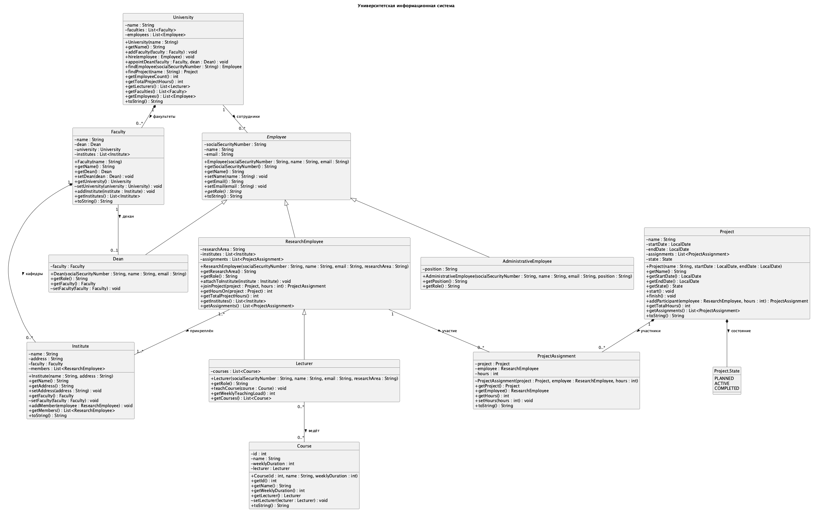
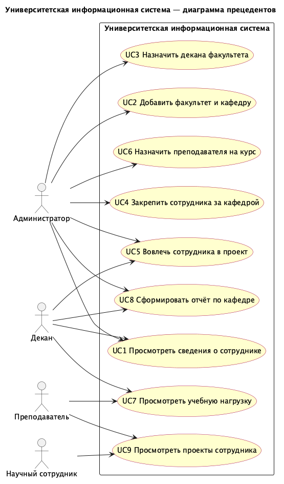
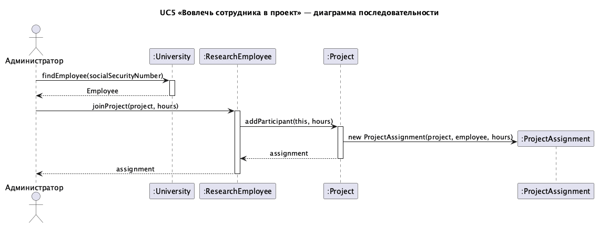
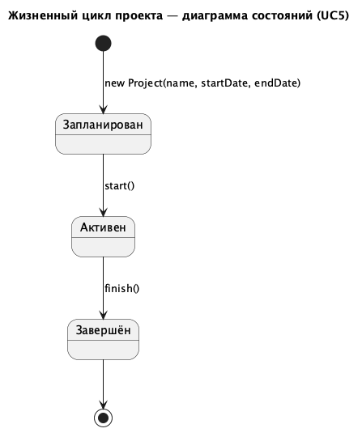
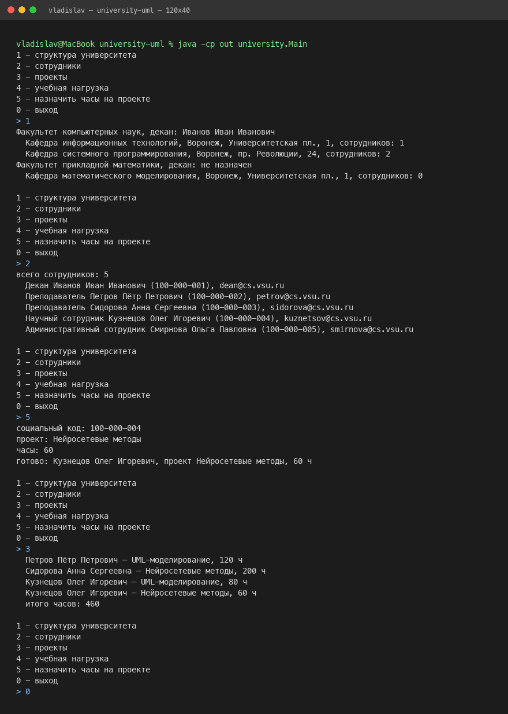

# Лабораторная работа 10. UML-модель университетской информационной системы

Модель системы и её реализация на Java: классы, прецеденты, диаграмма последовательности
и диаграмма состояний. Диаграммы сделаны в PlantUML, по диаграмме классов написан код.

## Что где лежит

```
model/              исходники диаграмм
src/university/     классы системы
docs/diagrams/      диаграммы в PNG
docs/screenshots/   скриншот работы программы и вывод сессии
build.sh            сборка и запуск
diagrams.sh         перерисовка диаграмм
```

## Классы

Из текста задания получились такие кандидаты в классы: университет, факультет, кафедра,
сотрудник, научный сотрудник, административный сотрудник, преподаватель, декан, проект, курс.
Часы участия в проекте вынесены в отдельный класс `ProjectAssignment`: это свойство связи
сотрудника с проектом, а не свойство кого-то из них.

Атрибуты:

- `University` — название, факультеты, сотрудники;
- `Faculty` — название, декан, университет, кафедры;
- `Institute` — название, адрес, факультет, сотрудники;
- `Employee` — социальный код, имя, e-mail;
- `ResearchEmployee` — область исследований, кафедры, участие в проектах;
- `Lecturer` — курсы;
- `AdministrativeEmployee` — должность;
- `Dean` — факультет;
- `Project` — название, дата начала, дата окончания, участники, состояние;
- `ProjectAssignment` — проект, сотрудник, часы;
- `Course` — номер, название, часы в неделю, преподаватель.

## Отношения

Университет состоит из факультетов, факультеты — из кафедр, это композиция. Декан связан
с факультетом ассоциацией и при этом является сотрудником, поэтому `Dean` наследуется от
`Employee`. Научный сотрудник прикреплён хотя бы к одной кафедре — ассоциация многие-ко-многим.
Участие в проекте — ассоциация с классом `ProjectAssignment`, в нём хранятся часы.
Преподаватель — это научный сотрудник, который ведёт курсы, отсюда обобщение
`ResearchEmployee <|-- Lecturer` и ассоциация с `Course`. Научный и административный персонал
тоже разведён обобщением.



## Прецеденты

Моделируется одна система — «Университетская информационная система». Акторы: администратор,
декан, научный сотрудник и преподаватель. В диаграмму попали только функции системы, без
алгоритмов:

- UC1 посмотреть сведения о сотруднике;
- UC2 добавить факультет и кафедру;
- UC3 назначить декана;
- UC4 закрепить сотрудника за кафедрой;
- UC5 вовлечь сотрудника в проект;
- UC6 назначить преподавателя на курс;
- UC7 посмотреть учебную нагрузку;
- UC8 сформировать отчёт по кафедре;
- UC9 посмотреть проекты сотрудника.



## Поведение

Для UC5 построена диаграмма последовательности. Объекты на ней — экземпляры классов модели,
сообщения — вызовы методов, которые есть в коде: `findEmployee`, `joinProject`, `addParticipant`
и конструктор `ProjectAssignment`.



Состояние проекта меняется методами `start()` и `finish()`, это же видно на диаграмме состояний.



## Код

Код лежит в `src/university`. Классы, атрибуты, методы и кратности в модели и в коде совпадают,
диаграмма классов соответствует исходникам. В `Main` есть меню: структура университета,
сотрудники, проекты, учебная нагрузка и назначение часов сотруднику на проекте.

Сборка и запуск (нужен JDK 17 или новее):

```
./build.sh
```

или вручную:

```
javac -encoding UTF-8 -d out $(find src -name '*.java')
java -cp out university.Main
```

## Скриншот



Текст сессии сохранён в `docs/screenshots/session.txt`.
